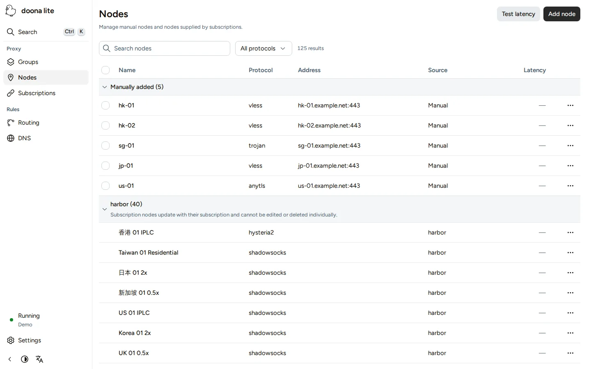

[繁體中文](../zh-TW/lite.md) / [简体中文](../zh-CN/lite.md) / English

# doona lite

doona lite provides forms for common honk configuration tasks. It is a preview in testing; see the [edition comparison](editions.md) before choosing it for your gateway.

Use **Nodes**, **Subscriptions**, **Groups**, **Routing** and **DNS** to manage resources, and **Settings** for global settings. Begin with [Connect doona lite](lite-connect.md), then follow [Common tasks](lite-tasks.md).

## Install doona lite

honk embeds doona lite starting with v0.1.0-beta.4. Follow [Quick start](quick-start.md) with the same `native_api` block, changing only `ui` to `'embedded-lite'`.

For a separate installation, use the lite archive in [Manual installation](install-manual.md). Apply the [UI restart rule](what-doona-can-change.md#restart-native), then [connect doona lite](lite-connect.md).

## Switch to the standard edition

Follow [Install and switch editions](editions.md#editions-switch) to select the standard edition's files or embedded UI.
